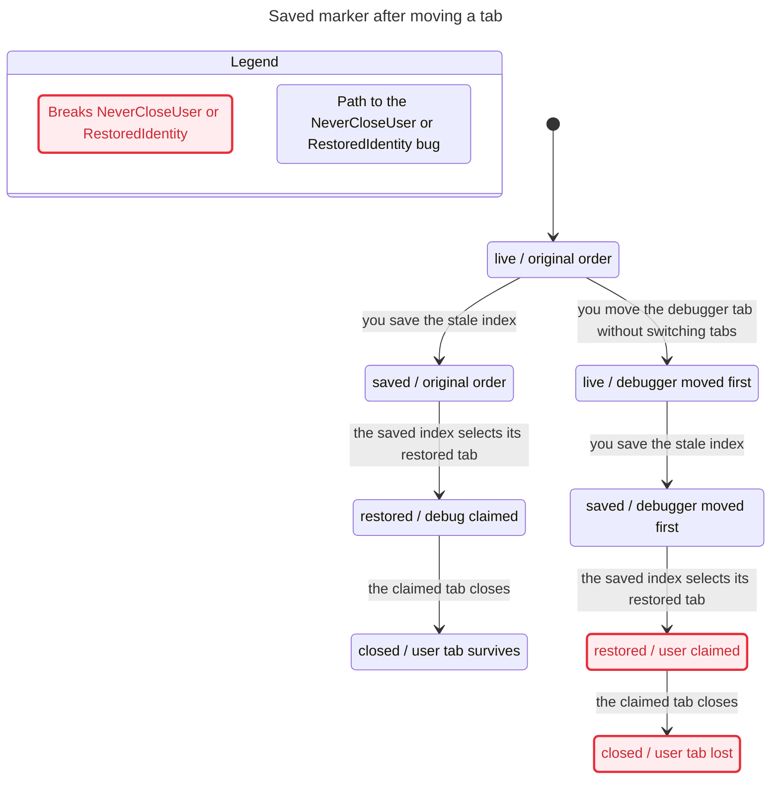
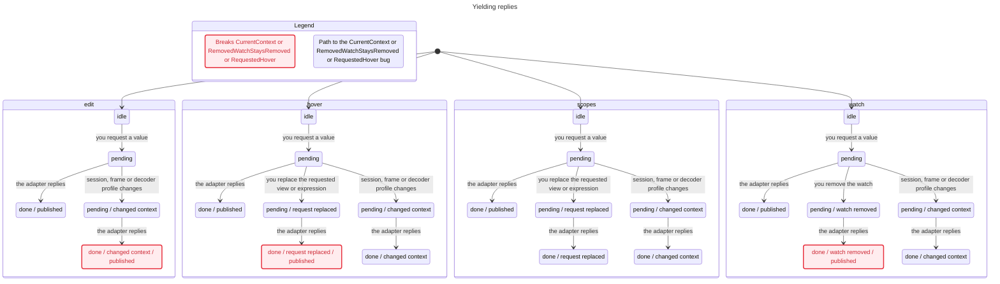
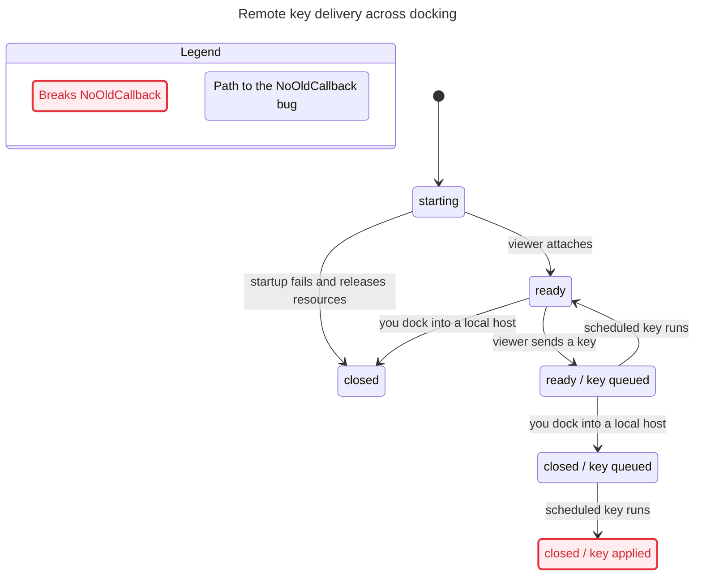
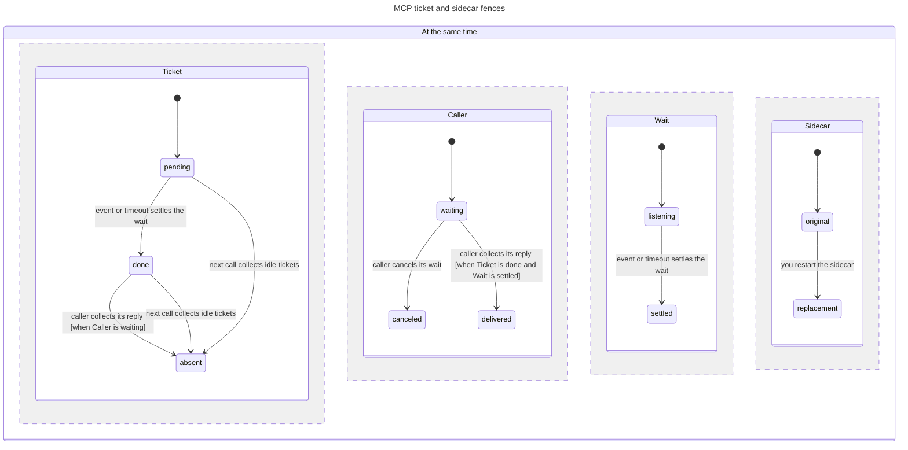
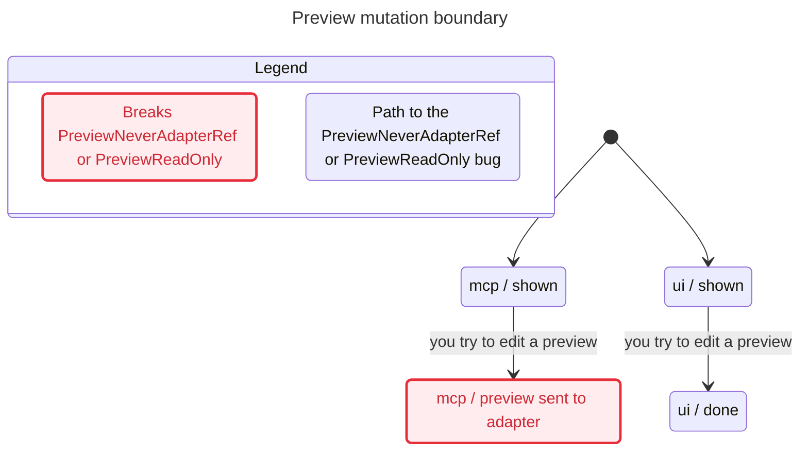
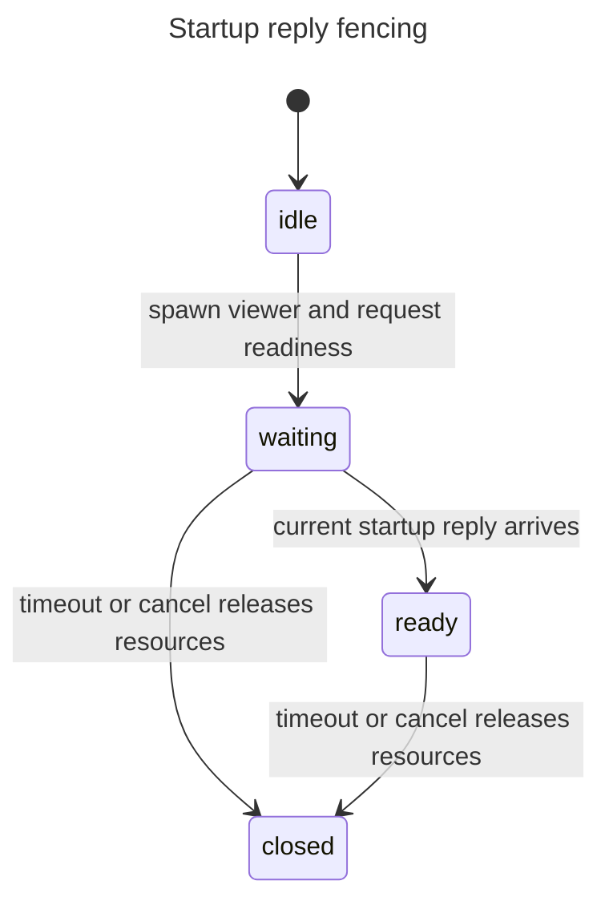

# Candidate 29aa630 correctness audit

**Hold merge: seven defects reproduced, including unrelated user-tab loss.**

HEAD `29aa630ae440f73a9ef421ce12df6bf30edd406a`. Production checkout unchanged. No child agents, commits/pushes, PR operations, user editor/pane/socket/settings changes or global tool configuration changes. Parent owns `dv-c5r.9`.

This is a whole-runtime inventory with focused executable lifecycle verification, not a proof that every line is correct. [coverage.tsv](coverage.tsv) maps all 128 runtime Lua/Go files (14,302 lines) to modeled, manual, stateless/setup, or explicitly excluded areas. [async-boundaries.txt](async-boundaries.txt) inventories yielding/deferred boundaries across that entire surface. Tests/examples/docs/Go test harness are outside runtime inventory. Classification does not claim equal manual review depth for every file.

## Confirmed replayed defects

| Severity | Defect and implementation | Replay evidence |
|---|---|---|
| P1 | **Moved debugger tab closes unrelated user tab on session restore.** `host/tab.lua:108` refreshes numeric marker only on TabNew/TabClosed/TabEnter. `tabmove 0` updates none. `vim-sessions.lua:110,141,171` trusts stale index and closes the selected restored user tab. | Real writer moves debugger from index 2 to 1 while marker stays 2, saves a session; real reader restores two tabs; scheduled cleanup invalidates unrelated user tab. [tabmove-replay.log](tabmove-replay.log). Refresh ownership marker at session-write boundary, including supported older Neovim paths. |
| P2 | **Old JS setExpression reply mutates new session cache.** `views/set.lua:86` writes value and workaround flag before the guarded refresh. | Request → change active session/invalidate epoch → old reply stores `OLD_SESSION`. [replay.log](replay.log), CurrentContext. Guard cache mutation too. |
| P2 | **Old hover reply replaces current expression's result.** `hover/eval.lua:23-28` checks session/frame/generation, not requested hover or request sequence. | Old evaluate yields → requested hover becomes new → reply publishes `OLD_HOVER`. Actual evaluator, controlled adapter completion. [replay.log](replay.log), RequestedHover. |
| P2 | **Pending refresh resurrects removed watch.** `watches/eval.lua:83` republishes when context matches, regardless of watch removal. | Begin refresh → actual remove_watch_expr deletes x → adapter completion reinserts x. [replay.log](replay.log), RemovedWatchStaysRemoved. Track expression registration/version while preserving first-add behavior. |
| P2 | **Queued remote key executes in replacement local host.** `host/remote.lua:739` schedules work without capturing remote lifetime/channel/host identity. | Real isolated PTY viewer ready → actual owner on_key queues X → dock into tab host → queued X invokes new host mapping (`hits=1`). [remote-replay.log](remote-replay.log). Notification handler entered directly after real viewer startup to make ordering deterministic. |
| P2 | **MCP mutation forwards decoder preview reference to adapter.** `dap-mcp/tools/variables.lua:103-112` checks numeric type, not positivity; UI setter rejects negative parents. | A real decoder-generated negative ref passed through actual dispatcher/set_variable to recording fake adapter: `setVariable.variablesReference=-1`. [replay.log](replay.log), PreviewReadOnly / PreviewNeverAdapterRef. This confirms invalid forwarding, not that real adapters accept negative refs. |
| P2 | **Child-watch full-value tooltip crashes.** `tree/value.lua:31` accesses variable_view.variable, but watches/view.lua records variable_view.view.variable. | Actual indexed watch record → value_at(2) → nil-field error. [replay.log](replay.log), WatchTooltip. Source-discovered and replayed, outside lifecycle model. |

Model-only counterexamples: **none in final models**. All eight failed rule traces replayed; two pairs of rules identify the same underlying defect.

## Final model results

91 reachable states / 213 steps across six small finite models. Eight failed safety rules; eight other safety rules and all six NoDeadlock checks hold. No temporal/liveness properties checked. No runner-reported unchecked rules. Counts include exploration after invariant violations; displayed charts merge equivalent labels.

| Model / final output folder | States | Steps | Failing rules | Holding safety rules |
|---|---:|---:|---|---|
| [Ownership](ownership-review/report.md) | 8 | 9 | RestoredIdentity, NeverCloseUser | none |
| [Replies](replies-review/report.md) | 26 | 33 | CurrentContext, RequestedHover, RemovedWatchStaysRemoved | RequestedScopes |
| [Remote](remote-final/report.md) | 6 | 9 | NoOldCallback | none |
| [Tickets](tickets-review/report.md) | 42 | 151 | none | AtMostOnce, CanceledCannotDeliver, SettledReleasesWait, OldExitKeepsReplacement |
| [Preview](preview/report.md) | 4 | 4 | PreviewReadOnly, PreviewNeverAdapterRef | none |
| [Startup](startup/report.md) | 5 | 7 | none | ClosedReleases, ClosedNotReady, ReadyOwns |

The first ownership model incorrectly updated marker during reorder and passed. The actual tabmove probe contradicted that assumption; the model was corrected. Only ownership-review is authoritative; earlier output folders are investigation history. No invariant was weakened to get a pass. A view-module error from using Array.includes on a TLA sequence object was corrected to Object.values; it did not change model semantics.

## Rules and report-numbered paths

- **RestoredIdentity:** restore claims the originally owned debugger tab. Ownership **0 → 1 reorder → 2 save → 3 restore**. Actual writer/reader replay steps 1–3.
- **NeverCloseUser:** never close an unrelated user tab. Ownership **0 → 1 reorder → 2 save → 3 restore → 4 close**. Same replay through step 4.
- **CurrentContext:** publish/cache a reply only for current session/frame/profile. Replies **0 edit idle → 1 request → 2 context changes → 3 reply**. Controlled adapter coroutine resumed after active-session replacement and decoder invalidation.
- **RequestedHover:** publish only for currently requested hover. Replies **0 hover idle → 1 request → 2 request changes → 3 reply**. Controlled evaluator replay changes requested expression before resuming.
- **RemovedWatchStaysRemoved:** deleting watch cancels publication by its pending refresh. Replies **0 watch idle → 1 request → 2 remove → 3 reply**. Actual remove/evaluator replay. **Added invariant for assessment:** deletion should keep an expression absent until explicitly re-added. This interprets requested-view identity; it was not an independently supplied product rule.
- **NoOldCallback:** callbacks from torn-down remote must not affect replacement host. Remote **0 starting → 1 ready → 2 key queued → 3 dock → 4 scheduled key runs**. Real PTY replay steps 1–4.
- **PreviewReadOnly / PreviewNeverAdapterRef:** preview nodes cannot be written or sent as adapter refs. Preview **0 MCP preview shown → 1 edit**. Real decoder-generated preview + actual dispatcher/tool + recording adapter stub. Both rules break in the same chart node.

## Implementation-derived guards and omissions

| Model/region | Implementation correspondence | Finite limits / excluded interactions |
|---|---|---|
| Ownership | Marker updated on TabNew/TabClosed/TabEnter, not tabmove. Save preserves numeric index. Restore consumes index against restored order; scheduled cleanup closes resolved handle. | Two tabs, one reorder, serial save/restore. No concurrent restore callbacks, forged globals, third-party session transforms, last-tab recovery, window geometry/API errors, terminal relocation. |
| Replies | Decoder context = generation/session object/frame ID. Scopes additionally checks render generation, requested section, buffer/window, root stack. Watch assignment only checks decoder context. Hover ignores requested expression. JS cache update precedes guarded refresh. | One request per selected mode; one interference (context/request/removal). Session/frame/profile collapse into one epoch. No frame-ID ABA, multiple overlapping refreshes, recursive traversal mutation, input-dialog completion races, hover-window cleanup assertions, async parser callback, cursor restoration after scopes yields. |
| Preview | Plugin negative refs intercepted by resolver; UI setter rejects negative parent; MCP setter checks number only. | One preview/two mutation entry points. No exhaustive decoder payload/type/rename/name escaping validation or target-language behavior. |
| Remote | Startup replies match pending monotonically increasing IDs; close settles pending request. Key handler schedules then reads current shared state without remote identity. | One viewer lifecycle. Real PTY replay covers key/dock order. Old resize/overlay/debounce callbacks, reentrant opens during socket connect, malformed attach replies, filesystem errors and mux semantics excluded. |
| Tickets | Dispatcher resolves once; poll/completion renew TTL; collection drops ticket; callback ignores missing entry. Go caller cancellation prevents external delivery but does not cancel Lua work. Wait finish removes listeners/stops timer. Sidecar old exit compares PID. | One ticket, two age buckets, two distinct process IDs. Active callers assumed to poll before five-minute TTL. Cancel is caller-side: Lua ticket/listeners may remain until event/timer/GC. Expiry/reset collapsed into absent-ticket boundary. No eventual-completion guarantee, precise timer cancellation, mutex/goroutine starvation, simultaneous calls, PID reuse, status assembly, event/session filtering, HTTP registry concurrency. |
| Startup | Accept reply only while pending; cancel/timeout clears logical owner resources/readiness; late reply ignored. | Notification-wait interval only; successful spawn/connect modeled atomically. Resource cleanup assumes cooperative mux/process close, not proof that failed OS kills leave no process. Sidecar running-before-ready distinction and blocked synchronous mux spawn excluded. |

No TLC CONSTRAINT, SYMMETRY or VIEW reductions; domains/action guards make each model finite. No fairness assumptions. Active-wait usability is supported by renewing polls and passing MCP checks, not proven as a temporal property. Decoder command execution/raw-node recursive callback fencing/cache-key collisions/payload completeness are not exhaustively checked by Replies.

Whole-surface coverage: host/session/console ownership mapped to Ownership plus stated layout exclusions; scopes/watches/hover/decoder/edit mapped to Replies/Preview; remote/viewer/sidecar/dispatch/wait/bridge mapped to Remote/Startup/Tickets. Threads/breakpoints/exceptions/sessions/console renderers, fold/reroot/truncation, winbar/controls/input/virtual-text/window helpers are explicitly manual or excluded UI regions. Config/schema/types/format helpers have no separately modeled yielding lifecycle. MCP tools/status/server/main are inventoried; their full composition is not proven by ticket checks. Per-file classifications and hashes: coverage.tsv.

## Validation

- Three persistent headless replay programs reproduce all defects. Probes assert observed defective behavior; fixing production should make these assertions fail until converted to regression expectations.
- scopes_race: **10 passed** ([log](scopes-race.log)).
- session_restore_tabpage: **11 passed** ([log](session-restore.log)).
- decoder_names: **7 passed** ([log](decoder-names.log)).
- MCP tests/run.lua: **215 passed** ([log](mcp-tests.log)).
- sidecar_lifecycle.lua: **9 passed**, including occupied-port failure / immediate restart ([log](sidecar-tests.log)).
- Existing 50 UI runs / real integrations supplied as prior evidence; not rerun in full here.

Commands run from checkout:

```sh
DAP_REPO="$PWD" nvim --headless -u NONE -l docs/audits/statechart/2026-11-07/replays/replay.lua
DAP_REPO="$PWD" nvim --headless -u NONE -l docs/audits/statechart/2026-11-07/replays/remote-replay.lua
DAP_REPO="$PWD" nvim --headless -u NONE -l docs/audits/statechart/2026-11-07/replays/tabmove-replay.lua
nvim --headless -u NONE -l tests/cases/scopes_race.lua
nvim --headless -u NONE -l tests/cases/session_restore_tabpage.lua
nvim --headless -u NONE -l tests/cases/decoder_names.lua
nvim --headless -u NONE -l nvim-dap-mcp/tests/run.lua
nvim --headless -u NONE -l nvim-dap-mcp/tests/sidecar_lifecycle.lua
```

## Source, output and reproduction

Reusable model/config/view sources and three replay programs: `docs/audits/statechart/2026-11-07/models/`. Required concise topic/root indices updated. Generated reports/logs/charts stay under `/tmp/dap-view-statechart-29aa630/`. Source-only promotion adds comments; no semantics changed. Promoted Preview rerun validated source/config/view discovery. Scratch contains no isolated report/prompt.

Reproduce each finite model with a **new** output folder; exit 1 is expected for rule failures:

```sh
skill=/path/to/pstack/skills/statechart
models="$PWD/docs/audits/statechart/2026-11-07/models"
for name in Ownership Replies Remote Tickets Preview Startup; do
  "$skill/scripts/statechart" "$models/$name.tla" \
    --config "$models/$name.cfg" --view "$models/$name.view.mjs" \
    --out "/tmp/dap-view-statechart-rerun-$name"
done
```

Final directories in model table each contain skill-generated report.md/chart.mmd/tlc.out and any per-rule TLC output emitted by skill. Each SVG is retained beside chart.mmd.

Pele 1.9.0 installed outside checkout:

```sh
npm install --prefix /tmp/dap-view-statechart-29aa630/renderer pele@1.9.0 --no-audit --no-fund
node /tmp/dap-view-statechart-29aa630/render.mjs \
  /tmp/dap-view-statechart-29aa630/ownership-review \
  /tmp/dap-view-statechart-29aa630/replies-review \
  /tmp/dap-view-statechart-29aa630/remote-final \
  /tmp/dap-view-statechart-29aa630/tickets-review \
  /tmp/dap-view-statechart-29aa630/preview \
  /tmp/dap-view-statechart-29aa630/startup
```

render() uses `{limit: 1_000_000, outputLimit: 8_000_000, maxEdges: 10_000}`. No browser/server. Skill used cached TLC/Java; no global mise/tool configuration change required.

## Charts and Mermaid text

Charts hide only steps whose endpoints have the same label (terminal stutter, invisible TTL/poll/PID-fenced callbacks); no view selectively returns null. Replies has 22 arrows to preserve distinct bug paths. Exact hidden self-transition counts are in generated reports. Ownership exposes reorder/save/claimed identities explicitly.

### Ownership

[Skill report](ownership-review/report.md) · [Mermaid](ownership-review/chart.mmd) · [Pele SVG](ownership-review/chart.svg)





### Replies

[Skill report](replies-review/report.md) · [Mermaid](replies-review/chart.mmd) · [Pele SVG](replies-review/chart.svg)





### Remote

[Skill report](remote-final/report.md) · [Mermaid](remote-final/chart.mmd) · [Pele SVG](remote-final/chart.svg)





### Tickets

[Skill report](tickets-review/report.md) · [Mermaid](tickets-review/chart.mmd) · [Pele SVG](tickets-review/chart.svg)




### Preview

[Skill report](preview/report.md) · [Mermaid](preview/chart.mmd) · [Pele SVG](preview/chart.svg)





### Startup

[Skill report](startup/report.md) · [Mermaid](startup/chart.mmd) · [Pele SVG](startup/chart.svg)



